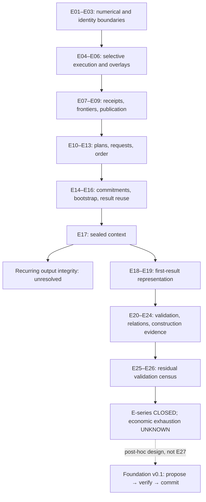

# Historical branch map

This synopsis groups the evidence-linked progression in `differential-validation-graph.json`. Arrows indicate historical focus, not elimination of earlier cost or a common timing denominator.

Each range is supported by its experiment report IDs in the public evidence catalog. The Foundation branch is a subsequent design choice. It is not an experimentally nominated optimization.
